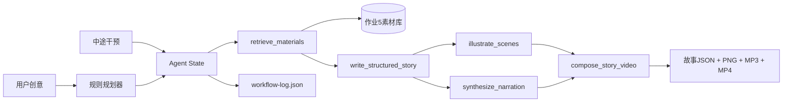

# Agent系统架构

## 为什么使用确定性规划器

课程要求使用Agent框架和至少4个工具，但并不要求规划本身必须再次调用收费LLM。本项目用LangChain Core统一工具接口，用可解释的状态机完成规划。这样现场没有API额度也能运行，工具输入输出可以复现。

如果后续配置作业1云API，可把 `write_structured_story` 内部替换为 `StoryGenerator`，保持其他工具和状态结构不变。

## 中途干预机制

1. Agent先生成可见的五步计划。
2. 用户在媒体生成前输入自然语言修改。
3. `intervene()`识别人物、名字或场景关键词。
4. 更新 `AgentState`，清空旧 `materials/story/artifacts`。
5. 工作流从素材检索重新执行，避免新旧状态混用。

